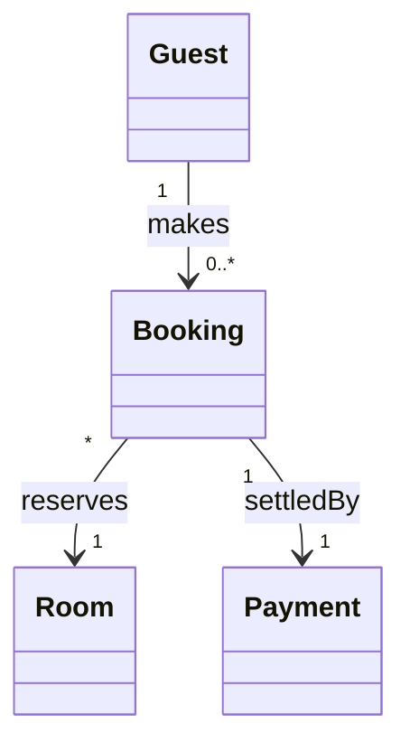

# Hotel Booking System: UML Class Diagram

**Course:** Data Science / UML Modelling
**Institution:** Université Libre de Kigali (ULK)
**Instructor:** Eric Maniraguha
**Team Members:** [Mohamed Tarig Ahmed Taha][202513604] and [Abubaker Abuobaida Mohammedalbashir Ali][202513108]
**Date:** 19th of October 2026

---

## 1. Project Introduction

The **Hotel Booking System** is an object-oriented design project that models how a hotel manages its guests, rooms, reservations and payments. The main deliverable is a **UML Class Diagram** that captures the static structure of the system: its classes, their attributes and operations, and the relationships between them.

This repository contains the design documentation for the system. It does not contain a working implementation.

## 2. Business Idea

Many small and medium-sized hotels still record reservations in notebooks or spreadsheets. This leads to double bookings, lost guest records and unclear payment histories. Our business idea is a simple, centralised system that lets a hotel:

- register guests and keep their details in one place,
- keep an accurate record of every room, its type, price and status,
- create and track reservations without conflicts,
- record payments and link each one to the booking it settles.

## 3. Project Scope

### Included

| Function | Description |
|---|---|
| **Guest registration** | Capture and maintain guest personal and contact information. |
| **Room management** | Add rooms, set prices and types, check availability and update room status. |
| **Booking reservations** | Create, modify, cancel and track reservations for a guest and a room. |
| **Payment processing** | Record payments made for a booking, track payment status and issue receipts (recorded inside the system only). |

### Excluded

| Out of scope | Reason |
|---|---|
| **Third-party live credit card gateways** | Payments are modelled as records only; no real connection to external payment providers. |
| **Staff payroll** | Employee salary and HR management is a separate domain. |
| **Physical inventory** | Tracking of items such as linens, food or supplies is not covered. |

## 4. Overview of the Main Classes

| Class | Purpose |
|---|---|
| **Guest** | Represents a person who registers with the hotel and makes bookings. |
| **Room** | Represents a physical hotel room with a type, price, capacity and status. |
| **Booking** | Represents a reservation linking one guest to one room for a date range. |
| **Payment** | Represents a payment made to settle a booking. |

### Relationships at a Glance

| Relationship | Multiplicity | Meaning |
|---|---|---|
| Guest to Booking | `1` to `0..*` | One guest can make zero or many bookings. |
| Booking to Room | `*` to `1` | Many bookings (over time) can refer to one room; each booking is for exactly one room. |
| Booking to Payment | `1` to `1` | Each booking is settled by exactly one payment record. |



The full class breakdown (attributes, methods and explanations) is in the reports below.

## 5. Repository Structure

```
hotel-booking-system/
├── README.md
├── reports/
│   ├── Report1_Project_Description.md
│   └── Report2_UML_Class_Diagram.md
└── diagrams/
    └── hotel-booking-class-diagram.png   (export from your UML tool)
```

## 6. Tools

- UML modelling tool of your choice (e.g. StarUML, draw.io, Lucidchart, PlantUML)
- Git and GitHub for version control and collaboration
- Markdown for documentation
