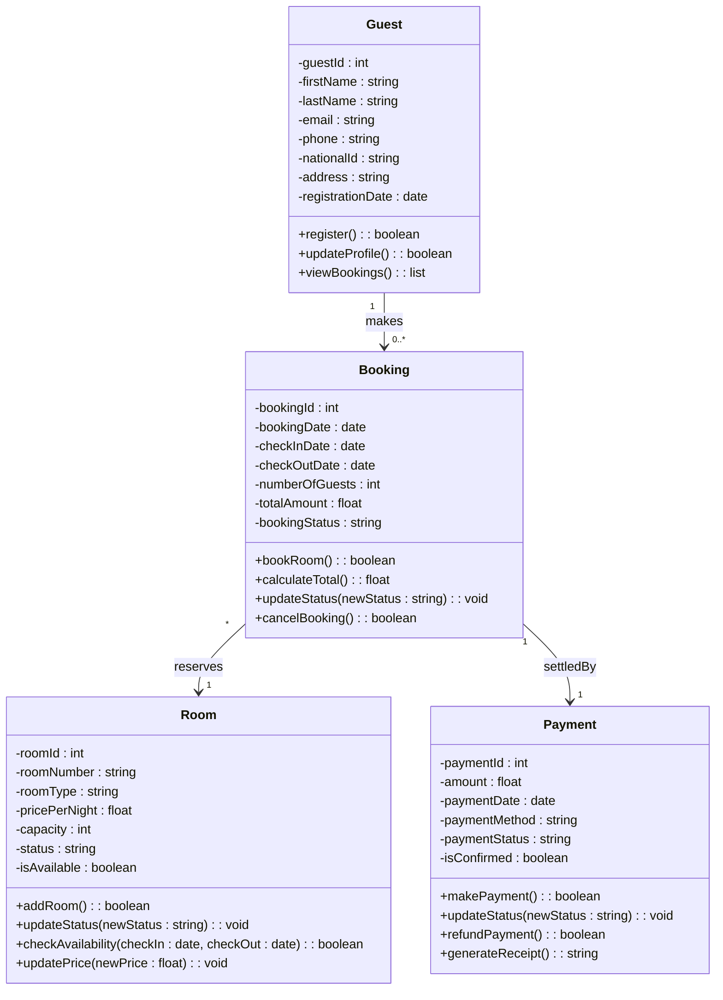

# Report 2: UML Class Diagram Report

**Course:** Software Engineering / UML Modelling
**Institution:** Université Libre de Kigali (ULK)
**Instructor:** Eric Maniraguha
**Team Members:** [Student Name 1] and [Student Name 2]
**Date:** October 2026

---

## 1. Introduction

This report presents the UML Class Diagram for the **Hotel Booking System**. The diagram models four classes: **Guest**, **Room**, **Booking** and **Payment**. For each class it gives the attributes (with data types) and the operations, then it describes how the classes are related and with what multiplicities.

**Notation used:** `+` public, `-` private. Attributes are written `name : type`. Operations are written `name(parameters) : returnType`.

## 2. UML Class Diagram

> **Tip:** GitHub renders the Mermaid block above automatically. For the PDF submission, export the diagram as an image from a UML tool (StarUML, draw.io, PlantUML) or screenshot the rendered Mermaid diagram, and place it here.

## 3. Class Breakdown

### 3.1 Class: Guest

**Purpose:** Represents a person who registers with the hotel and makes reservations.

| Attribute | Data Type | Description |
|---|---|---|
| guestId | int | Unique identifier of the guest (primary key). |
| firstName | string | Guest's first name. |
| lastName | string | Guest's last name. |
| email | string | Guest's email address. |
| phone | string | Guest's contact phone number. |
| nationalId | string | National ID or passport number. |
| address | string | Guest's home address. |
| registrationDate | date | Date the guest registered. |

| Method | Return Type | Description |
|---|---|---|
| register() | boolean | Registers a new guest and saves their details. |
| updateProfile() | boolean | Updates the guest's personal or contact details. |
| viewBookings() | list | Returns all bookings made by this guest. |

### 3.2 Class: Room

**Purpose:** Represents a physical room in the hotel.

| Attribute | Data Type | Description |
|---|---|---|
| roomId | int | Unique identifier of the room (primary key). |
| roomNumber | string | Room number shown on the door (e.g. "101"). |
| roomType | string | Type of room (Single, Double, Suite). |
| pricePerNight | float | Cost of the room per night. |
| capacity | int | Maximum number of guests the room can hold. |
| status | string | Current state (Available, Booked, Maintenance). |
| isAvailable | boolean | Quick flag showing whether the room can be booked. |

| Method | Return Type | Description |
|---|---|---|
| addRoom() | boolean | Adds a new room to the system. |
| updateStatus(newStatus) | void | Changes the room's status. |
| checkAvailability(checkIn, checkOut) | boolean | Checks if the room is free for the given dates. |
| updatePrice(newPrice) | void | Changes the price per night. |

### 3.3 Class: Booking

**Purpose:** Represents a reservation of one room by one guest for a period of time.

| Attribute | Data Type | Description |
|---|---|---|
| bookingId | int | Unique identifier of the booking (primary key). |
| bookingDate | date | Date the booking was made. |
| checkInDate | date | Arrival date. |
| checkOutDate | date | Departure date. |
| numberOfGuests | int | Number of people staying. |
| totalAmount | float | Total cost of the stay. |
| bookingStatus | string | Current state (Pending, Confirmed, Cancelled, Completed). |

| Method | Return Type | Description |
|---|---|---|
| bookRoom() | boolean | Creates a booking for a guest and a room after checking availability. |
| calculateTotal() | float | Computes nights × room price. |
| updateStatus(newStatus) | void | Changes the booking status. |
| cancelBooking() | boolean | Cancels the booking and frees the room for those dates. |

### 3.4 Class: Payment

**Purpose:** Represents the payment made to settle a booking. It is recorded inside the system only (no live gateway).

| Attribute | Data Type | Description |
|---|---|---|
| paymentId | int | Unique identifier of the payment (primary key). |
| amount | float | Amount paid. |
| paymentDate | date | Date of the payment. |
| paymentMethod | string | Method used (Cash, Mobile Money, Card). |
| paymentStatus | string | Current state (Pending, Completed, Refunded). |
| isConfirmed | boolean | Whether the payment has been confirmed. |

| Method | Return Type | Description |
|---|---|---|
| makePayment() | boolean | Records a payment for a booking. |
| updateStatus(newStatus) | void | Changes the payment status. |
| refundPayment() | boolean | Marks the payment as refunded. |
| generateReceipt() | string | Produces a receipt for the payment. |

## 4. Relationships and Multiplicities

| # | Relationship | From | To | Multiplicity | Type |
|---|---|---|---|---|---|
| 1 | makes | Guest | Booking | `1` to `0..*` | Association |
| 2 | reserves | Booking | Room | `*` to `1` | Association |
| 3 | settledBy | Booking | Payment | `1` to `1` | Association |

### 4.1 Guest to Booking (1 to 0..*)

A **Guest makes zero or many Bookings**. A guest can register without booking anything yet (the 0 end), and a returning guest can make many bookings over time (the * end). In the other direction, every Booking must belong to **exactly one** Guest, because a reservation cannot exist without the person who made it. In the implementation, `Booking` would hold a foreign key `guestId`.

### 4.2 Booking to Room (* to 1)

**Many Bookings can refer to one Room**, but each Booking reserves **exactly one** Room. A room is reserved again and again over time by different guests, so it accumulates many bookings, provided their date ranges never overlap. This rule is enforced by `checkAvailability()` before `bookRoom()` succeeds. A guest who needs several rooms creates several bookings. In the implementation, `Booking` would hold a foreign key `roomId`.

### 4.3 Booking to Payment (1 to 1)

Each **Booking is settled by exactly one Payment**, and each Payment belongs to exactly one Booking. This one-to-one relationship keeps financial records easy to trace: from any payment we can find the booking it settles, and from any booking we can see its payment. In the implementation, `Payment` would hold a foreign key `bookingId` with a uniqueness constraint.

> **Design note:** A real hotel may accept deposits or instalments, which would make this relationship `1` to `1..*`. We use `1` to `1` as specified by the assignment, to keep the model simple.

## 5. Summary

The class diagram uses **Booking** as the central class: it links a **Guest** to a **Room** and is itself paid for by a **Payment**. The relationships and multiplicities enforce the main business rules of the system:

- a booking always has one guest, one room and one payment,
- a guest and a room can each be involved in many bookings,
- a guest may exist without any booking yet.

This structure is a solid base for implementing the system with a database and an object-oriented language.
